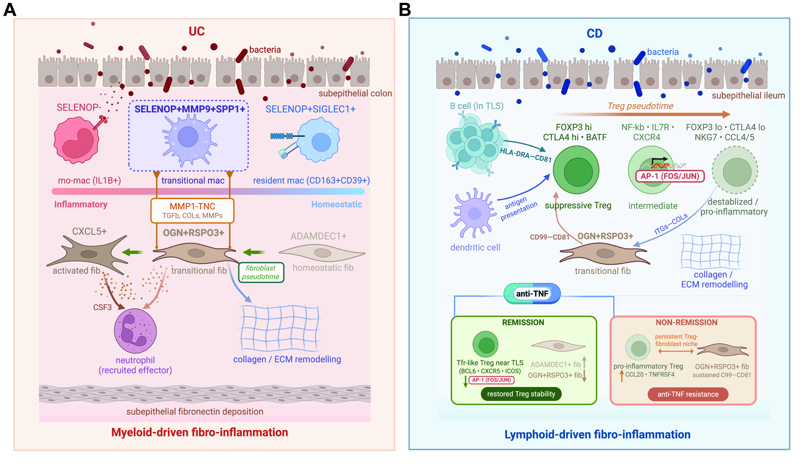

# MultiOmics Gut Atlas

Code for **"Integrated single-cell and spatial atlases reveal myeloid–stromal niches linked to tissue remodeling and immune regulation in inflammatory bowel disease."**

Yanyi Ding, Yawei Li, Cenfu Wei, Shannon Keenan, Yiming Li, Jiwoon Park, Wenjing Yang, Libeth Rosas, Frida Chavez, Isabella Peshek, Stephen B. Hanauer, Emanuelle Bellaguarda, Laura Yun, Christine Boumtri, Vitaliy Poylin, Randy Longman, Alexandra Livanos, Saurabh Mehandru, Ronen Sumagin, Yingzi Cong, Prajan Divakar, Michael Patrick, Liang Zhang, Kimberly Young, Ashley Heck, Mithra Korukonda, Daniel McGuire, Joseph Beechem, Christopher Mason, Mark T. Osterman, Melody Morris, Yuan Luo\*, Parambir S. Dulai\*



## The study

We integrated public and new single-cell RNA-seq data into atlases of ulcerative colitis (UC) and Crohn's disease (CD), and profiled UC and CD tissue with CosMx spatial transcriptomics (1K, 6K and whole-transcriptome panels) and CosMx spatial proteomics.

- **UC.** With inflammation, macrophages shift from SELENOP⁺ resident to monocyte-derived states, alongside fibroblast activation from ADAMDEC1⁺ through OGN⁺RSPO3⁺ to activated states. In tissue, SELENOP⁺MMP9⁺SPP1⁺ macrophages co-localise with activated and TNC-high OGN⁺RSPO3⁺ fibroblasts. A graph-based model imputes genes missing from lower-plex CosMx panels.
- **CD.** Tregs lose suppressive programs along a pseudotime trajectory. A Treg Suppression Score derived from this trajectory is high in antigen-presenting niches and near dendritic cells, and lower close to OGN⁺RSPO3⁺ fibroblast stroma, where CXCL12 is high.
- **Anti-TNF.** In the public TAURUS cohort, non-remission after anti-TNF is associated with persistent macrophage-derived signals of the low-suppression niche (OSM, IL1B, IL6).
- **Spatial proteomics.** Protein imaging separates inflammatory myeloid cells in UC from antigen-presenting myeloid cells and activated Tregs in CD.

## Data

| Data | Access |
|---|---|
| Integrated UC and CD scRNA-seq atlases | Built from public studies (Supplementary Tables 1, 2 and 8); processed objects will be shared through the figure repository: [link pending] |
| CosMx WTX, 6K and spatial proteomics (UC, CD) | [GSE339024](https://www.ncbi.nlm.nih.gov/geo/query/acc.cgi?acc=GSE339024); the additional UC CosMx 6K samples will be added there |
| CosMx 1K cohort (UC and CD) | [GSE312415](https://www.ncbi.nlm.nih.gov/geo/query/acc.cgi?acc=GSE312415) |
| CITE-seq with TCR-seq | [GSE311585](https://www.ncbi.nlm.nih.gov/geo/query/acc.cgi?acc=GSE311585) |
| TAURUS anti-TNF scRNA-seq | Thomas et al. (2024); access as described there |

## Repository layout

Each folder has its own README with one line per file (analysis, inputs, outputs, panels) and the run order.

```
uc_scrna/              UC scRNA-seq atlas: integration, annotation, macrophage and fibroblast analyses (Fig 2, Fig 3D/G)
cd_scrna/              CD scRNA-seq atlas and Treg pseudotime, pathways and ligand-receptor prioritization (Fig 4)
cosmx_uc/              UC CosMx 1K / 6K / WTX: processing, annotation, macrophage-fibroblast spatial analyses (Fig 3)
cosmx_cd/              CD CosMx: Treg label transfer, Treg Suppression Score, neighbourhoods, APCs, CXCL12-High Regions (Fig 5)
treatment_validation/  TAURUS anti-TNF scRNA-seq: Treg programs and cytokine sources (Fig 6)
cosmx_multiomics/      CosMx spatial proteomics, UC vs CD (Fig 7)
cite-tcr/              CITE-seq protein of macrophages; TCR repertoire of Tregs
imputation_model/      GCN gene-imputation model for lower-plex CosMx panels (with tutorial)
imputation_benchmark/  Benchmark of the GCN against Tangram, gimVI, stPlus, SPRITE and CellPLM
```

Files are numbered in run order within each folder. The longer analysis scripts are split into named sections, one per analysis step, so a single step can be run on its own:

```
python <file>.py                          # all sections in order
RUN_SECTIONS=<id>,<id> python <file>.py   # selected sections only
RUN_SECTIONS=<id> Rscript <file>.R
```

Paths are the lab's absolute paths for now and will be replaced by placeholders before public release.

## Environment

- **R 4.5:** Seurat (v5.1.0 for the atlases, v5.5.0 for the Treg, spatial and TAURUS scripts), CellChat (v2.2.0), nichenetr (v2.2.1), AUCell (v1.30.1), clusterProfiler (v4.16.0), lme4 (v2.0.1), lmerTest (v3.2.1), circlize (v0.4.16), UpSetR (v1.4.0), ragg (v1.5.2).
- **Python 3.10:** Scanpy (v1.10.2), anndata (v0.11.0), Squidpy (v1.6.2), decoupler (v2.1.1), Palantir (v1.4.2), LIANA (v1.6.1), harmonypy (v0.0.10), statsmodels (v0.14.5), PyDESeq2 (v0.5.2), scikit-learn (v1.5.1), pyarrow (v16.1.0), scvi-tools (v1.2.0).
- **scCODA** (`uc_scrna/09`, section `S3D_sccoda`): separate Python 3.12 environment with pertpy (v1.0.2).
- **OpenBLAS on Intel Sapphire Rapids (Xeon 8468):** OpenBLAS 0.3.20 can return wrong float64 matrix products on these CPUs. Set `OPENBLAS_CORETYPE=SkylakeX` before running Python there.
- **Threads:** the mixed-model sections in `cosmx_cd/` and `treatment_validation/` were run with `OPENBLAS_NUM_THREADS=32` (`cd_scrna/12` and `cd_scrna/13` with 16). Use the same value for bit-identical output.

## Figure and table map

The tables list the code behind each panel and supplementary table. "Not in repo" marks an upstream step whose code is not included; the folder READMEs give details.

| Figure | Panels → code |
|---|---|
| Fig 1 | Study design (no code) |
| Fig 2 | A-C `uc_scrna/02-08`; D `uc_scrna/03`; E `uc_scrna/09` (section `F2E_macrophage_subtype_composition`); F `uc_scrna/10` (gene-symbol harmonisation of its input: not in repo); G `uc_scrna/11`; H-J `uc_scrna/12` (per-sample ADAMDEC1⁺ fraction table: not in repo) |
| Fig 3 | A `cosmx_uc/05` (1K Seurat objects: not in repo); B-C `cosmx_uc/01`, `03`, `04`; D `uc_scrna/14`, `cosmx_uc/09`; E `cosmx_uc/07-09`; F `cosmx_uc/10`; G `uc_scrna/14-15`; H `cosmx_uc/07`, `11-12`; I-J `cosmx_uc/09` |
| Fig 4 | A-B `cd_scrna/01-10`; C `cd_scrna/11`; D-F `cd_scrna/12`; G `cd_scrna/14`; H-I `cd_scrna/15-16` |
| Fig 5 | A `cosmx_cd/14` (WTX biopsies `cosmx_cd/01-02`); B `cosmx_cd/11-12`, `14`; C `cosmx_cd/12-13`; D `cosmx_cd/15`; E-F `cosmx_cd/16`; score and inputs `cosmx_cd/03-10`, `cd_scrna/16` (resection cell metadata table: not in repo) |
| Fig 6 | A `treatment_validation/03`; B `treatment_validation/04`; data preparation `treatment_validation/01-02` |
| Fig 7 | A-E `cosmx_multiomics/05`; UC and CD objects `cosmx_multiomics/01-04` |
| Supp 1 | `uc_scrna/02-08` |
| Supp 2 | `uc_scrna/03`, `08` |
| Supp 3 | A `uc_scrna/04` (section 4); B-C `uc_scrna/01`, `06`; D `uc_scrna/09` |
| Supp 4 | A-B `cite-tcr/01-02`; C-D `uc_scrna/13` |
| Supp 5 | A-B `uc_scrna/13`; C `uc_scrna/16` |
| Supp 6 | A-C `cosmx_uc/01`; D `cosmx_uc/03`, `04` (UC 6K QC and normalisation: not in repo); E `cosmx_uc/10`; F `imputation_model/`; G-H `cosmx_uc/01`, `04`; I `cosmx_uc/04`; J `imputation_benchmark/`; K `cosmx_uc/01`; L `cosmx_uc/02`; M `cosmx_uc/06` |
| Supp 7 | A-E `cd_scrna/01-10`; F `cite-tcr/01`, `03`; G `cd_scrna/11` |
| Supp 8 | A-E `cd_scrna/13`; F `cd_scrna/14`; G-H `cd_scrna/16`; I `cite-tcr/04-05`, `cosmx_cd/08-09` |
| Supp 9 | A-B `cosmx_cd/12-13`; C `cosmx_cd/17`; D `cosmx_cd/15`; E-F `cosmx_cd/16` |
| Supp 10 | `treatment_validation/05` |

| Supplementary table | Code |
|---|---|
| 1 Datasets by modality; 2 UC atlas by study; 5 CosMx sample metadata; 6 custom probes; 8 CD atlas by study; 13 glossary | none (compiled from the study metadata) |
| 3 Lineage-wise silhouette scores | `uc_scrna/07-08` |
| 4 SELENOP⁺ vs SELENOP⁻ GSEA | `uc_scrna/10` |
| 7 GCN imputation benchmark | `imputation_benchmark/07` |
| 9 TCR repertoire | `cite-tcr/05` |
| 10 Gene sets, signatures and LR modules | `cosmx_cd/10` (score genes), `cosmx_cd/13` (LR modules), `cd_scrna/14` (pathway gene sets) |
| 11 TAURUS biopsy-level models | `treatment_validation/03-04` |
| 12 Spatial proteomics panel and marker use | `cosmx_multiomics/05` (gates and markers; the whole-panel marker screen is not in repo) |

### Run order across folders

`uc_scrna` and `cd_scrna` atlases first. `uc_scrna/14` feeds `cosmx_uc/08`. In `cd_scrna`, `12 → 13, 14, 15 → 16`; `cd_scrna/12` and `16` (section `immune_sender_ranking`) feed `cosmx_cd/08-10`; `cosmx_cd/09` feeds `cite-tcr/05`; `cd_scrna/12`, `14` and `cosmx_cd/10` feed `treatment_validation/03`. `imputation_model/` runs before the imputed-1K steps of `cosmx_uc/`.

## Citation

Pending DOI assignment.

## Contact

Yuan Luo (yuan.luo@northwestern.edu) and Parambir S. Dulai (parambir.dulai@northwestern.edu).
